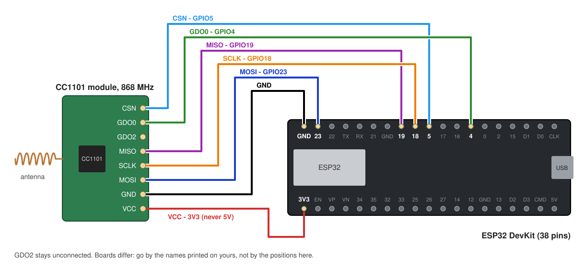
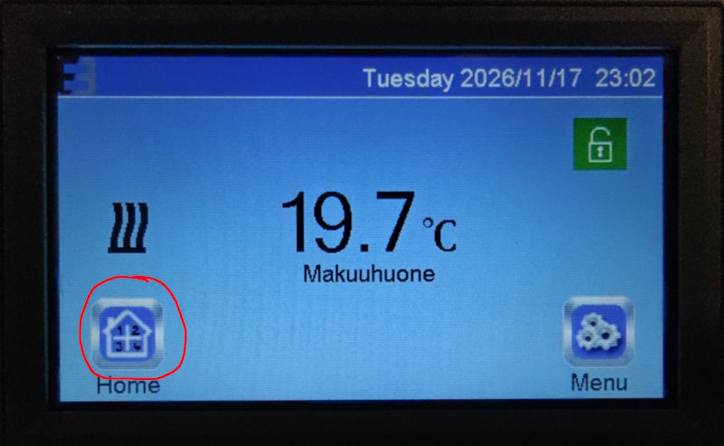
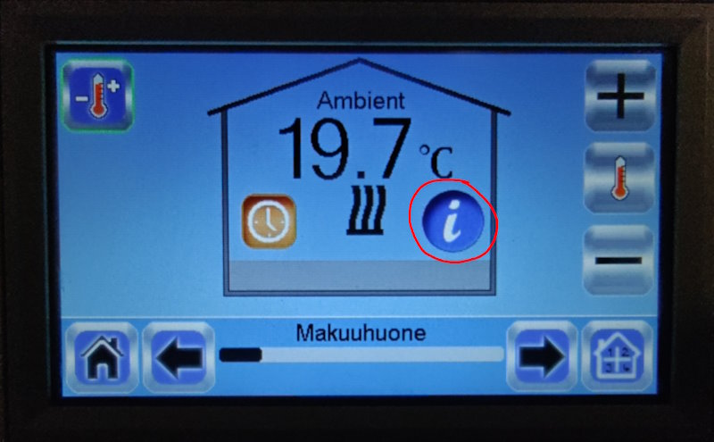
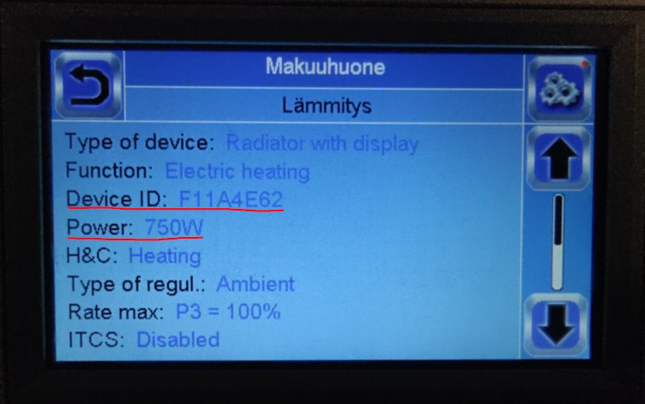
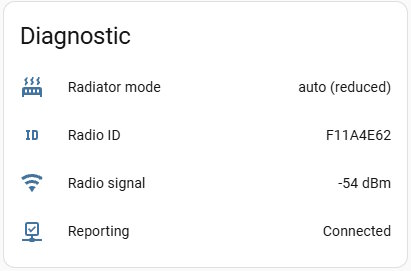
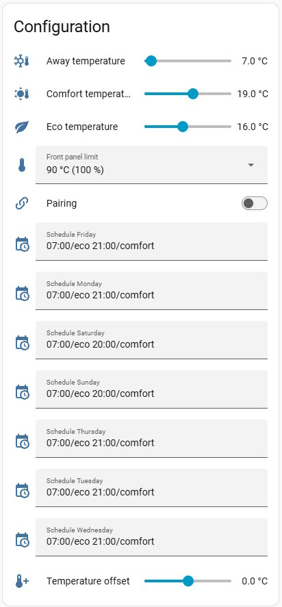
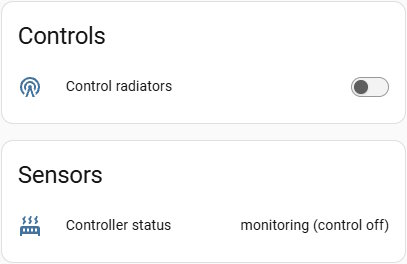
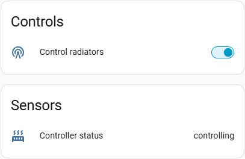

# CleverTouch (Touch E3) radiators over 868 MHz, without the E3

An [ESPHome](https://esphome.io) external component that controls CleverTouch
electric radiators directly over their 868 MHz radio, the way the Touch E3
controller does, with an ESP32 and a CC1101 radio module. No cloud, no E3:
Home Assistant gets a climate entity, sensors and a week schedule per radiator,
and the ESP keeps running the schedules on its own if Home Assistant or the
network is down.

> Not affiliated with or endorsed by Purmo Group, CleverTouch or any radiator
> brand. Names are used only to say what this works with.

## Status

Runs a house with seven **Purmo Yali Digital** single-panel radiators full
time, with the Touch E3 unplugged:

- five radiators that were paired to the E3 (they keep working without
  re-pairing), and two paired from the ESP;
- schedule switch points confirmed by the radiator within seconds;
- tested with Home Assistant stopped, across restarts of the ESP and after a
  short power cut. A Wi-Fi outage on its own has not been tested.

Other CleverTouch radiators and brands built on the Touch E3 should work the
same way, but haven't been tested. Reports are welcome. Double-panel radiators
haven't been tested either (see [Double-panel radiators](#double-panel-radiators)).

### Double-panel radiators

Control is the same for single and double panels, and nothing needs
configuring. Only the energy figure differs, and only while a front panel
limit below 100 % is set: the limit throttles just the front panel. With
`panels: 2` the energy is counted as a front panel with 40 % of the power
(limited) plus a back panel with 60 % (not limited), which matches the output
figures in the radiator manual (about ×0.90 at the 75 °C limit, ×0.80 at
60 °C). This is an estimate, not checked on a real double-panel radiator. If
you have one, a log of a few hours at a 70 % or 55 % limit, ideally with an
energy meter or smart plug reading for the same time, would settle it: open an
issue or get in touch.

`panels: 2` also adds a **Sequential control** switch: the radiator's own
"SrC" setting (front panel first, back panel only as a boost when the room is
1 °C below the setpoint). It shows what the radiator reports, so a setting
made on the radiator's buttons or by an E3 is kept; without `panels: 2` the
setting is simply passed through unchanged.

## Hardware

- An ESP32 board (ESP-IDF framework).
- A **CC1101 module for 868 MHz** (many are sold in a 433 MHz version, which
  looks the same; check the antenna and the listing).
- Wiring (module pins on most boards: VCC GND MOSI SCLK MISO GDO2 GDO0 CSN):

  | CC1101 | ESP32 |
  |---|---|
  | VCC | 3V3 (never 5 V) |
  | GND | GND |
  | MOSI | GPIO23 |
  | SCLK | GPIO18 |
  | MISO | GPIO19 |
  | GDO0 | GPIO4 |
  | CSN | GPIO5 |
  | GDO2 | not needed, leave unconnected |

  

- **Placement matters more than anything else.** Mount it high (about 1.5 m
  or more) with the antenna up: near the floor the signal fades by 5-10 dB.
  Inside a box, a spring antenna right next to the ESP32 board loses 10-30 dB;
  a simple wire dipole (two 82 mm legs, one from ANT going up, one from the
  module's GND going down) worked best.

## Install

See [`example/radiator-controller.yaml`](example/radiator-controller.yaml) for
a complete device config. The essentials:

```yaml
external_components:
  - source: github://jbacklun/esphome-clevertouch-radio
    components: [clevertouch_radio]

clevertouch_radio:
  control_radiators: DEFAULT_ON        # "Control radiators" on after the first flash
  # listen_after_boot: 0s              # if there's no E3 in the house
  radiators:
    - name: Bedroom
      radio_id: F1234567    # the radiator's Device ID in the E3; leave out to pair from the ESP
      watts: 750            # the E3's "Power", or the radiator's label; for the energy sensor
      comfort: 19           # starting temperatures (default 21 / 17 / 7)
      eco: 16
      # schedule: "daily 07:00 eco 21:00 comfort"   # optional starting schedule; see Schedule
      # panels: 2               # double-panel radiator (energy figure only; see below)
      # min_temperature: 5      # the radiator is never sent anything outside these
      # max_temperature: 30     # (off excepted); default 5 / 30
      # device_id: dev_bedroom   # optional sub-device (declared under esphome: devices:)
```

It also needs the `cc1101:` block with the E3's radio settings (copy it from
the example), a `time:` source (SNTP works without Home Assistant), and
`reboot_timeout: 0s` under both `api:` and `wifi:` so the ESP doesn't reboot
when Home Assistant or the network goes away.

**One Home Assistant device (and area) per radiator.** Declare sub-devices and
give each radiator its `device_id`; the entities then drop the radiator name
("Room temperature" on device "Bedroom radiator") and the climate entity takes
the device name. See the example.

**Keep `name:` fixed.** A radiator's `name` is the key of its stored state on
the ESP (schedule, temperatures, energy, a pairing made from the ESP).

All options are listed in the [configuration reference](#configuration-reference).

### Getting started: three routes

A radiator only listens to the controller it was paired to, by that
controller's ID. Which route you take depends on what your radiators are
paired to now.

**A) You have a working Touch E3.** No pairing needed.

1. Read each radiator's **Device ID** from the E3, and put it in the YAML as
   `radio_id`. On the E3: Home → choose the room with the arrows → the "i"
   button. The details also show the radiator's **Power**, which is the
   `watts:` value.

   
   
   

2. Install the ESP with "Control radiators" on. While the E3 is running, the
   ESP only listens: Home Assistant shows what the E3 does, and you can check
   that every radiator is heard.
3. Unplug the E3. Five minutes later the ESP takes over, answering as the E3's
   ID and continuing from the E3's last settings. If anything goes wrong, plug
   the E3 back in and the ESP steps back.

**B) Your E3 is broken or gone, but the radiators were paired to it.** Also no
pairing needed: radiators keep reporting to their controller every few
minutes, even when it no longer answers (one radiator left unanswered was
still reporting after five days; if one has stopped after a longer time, route
C works). "Unconfigured devices heard" lists
them with their setpoint. To tell them apart, give each a different
temperature on its own buttons and wait for its next report (up to 4
minutes). Then put the IDs in the YAML as `radio_id`; the ESP takes them over
as in A.

**C) No E3, or radiators that were never paired.** Pair each radiator from the
ESP:

1. Add the radiator to the YAML without `radio_id`, and install.
2. Turn "Control radiators" on (on the controller's device). Then open the
   radiator you want to pair from your devices in Home Assistant, and under
   **Configuration** turn its **Pairing** switch on (see the
   [radiator's configuration](docs/images/device_configuration_ha.jpg)).
3. Within 2 minutes, put the radiator itself into pairing mode (see its
   manual). The switch turns off when the radiator joins, after 2 minutes, or
   at once if pairing can't start; "Controller status" says what happened. The
   radiator's values show up in Home Assistant within seconds.
4. Copy the radiator's "Radio ID" (under the device's Diagnostic) into the
   YAML as `radio_id`. Until then the pairing exists only in the ESP's flash.

   

Without an E3 in the house you can also set `listen_after_boot: 0s`, so the
ESP starts answering right after boot instead of listening for 5 minutes
first.

Pairing from the ESP has been tested with radiators taking the ID learned from
an E3. A completely fresh install, where the ESP makes up its own ID, has not
been verified yet.

You can also re-pair E3 radiators to the ESP this way, but route A does the
same without touching the radiators.

### Later changes

- **Pairing again** (a radiator that was reset, or paired to another
  controller): the same "Pairing" switch, which every radiator has. With a
  `radio_id` in the YAML, only that radiator is accepted, and a radiator
  configured under another name never is, so the wrong radiator can't end up
  in the wrong room. A radiator that has lost its pairing should stop
  reporting to the ESP (not tested); its "Reporting" sensor then turns off
  after 20 minutes.
- **Removing a radiator:** delete it from the YAML. Nothing needs to be sent:
  an E3 doesn't tell a deleted radiator anything either.

**Controller ID.** You don't need to set one. The component answers each
radiator as whatever ID it reports to, so radiators paired to an E3, or to an
earlier ESP, keep working. For new pairings it uses `controller_id:` from the
YAML if set; else the ID learned from the first radiator report (stored in
flash); else one made from the ESP's MAC address (`F1` + the MAC's last three
bytes), stored the first time it is used. The "Controller ID" sensor shows which, e.g.
`F1ABCDEF (learned)`. Copying it into the YAML (`controller_id: F1ABCDEF`
under `clevertouch_radio:`) makes it explicit, for example before moving to a
new board, although a new board also learns it from the first report.

## What you get in Home Assistant

Per radiator:

| Entity | |
|---|---|
| climate | see below; current temperature; heating / idle |
| Room temperature, Heating power, Energy, Radio signal | sensors (energy = heating seconds × `watts`) |
| Radio ID | the radiator's ID; "(paired here, not in the YAML)" until you add it as `radio_id` |
| Radiator mode | what the radiator reports (comfort, reduced, auto (comfort), ...) |
| Schedule Monday ... Schedule Sunday | the week schedule (below) |
| Schedule status | what is in force: "eco 16.0 °C until 18:15", "override 16.5 °C until 18:15", "comfort (manual)" |
| Front panel limit | 90 / 75 / 60 °C (100 / 70 / 55 % power) |
| Comfort / Eco / Away temperature | the preset temperatures, settable without switching preset |
| Temperature offset | correction for the radiator's room sensor, −5…+5 °C in 0.1 °C steps (the E3's "offset"; taken over from an E3) |
| Reporting | on while the radiator is heard; off after 20 minutes without a report |
| Pairing | switch, to pair (or pair again) |
| Sequential control | switch, double panels only (`panels: 2`): front panel first, back panel only as a boost 1 °C below the setpoint |

Climate modes and presets:

| Home Assistant | Radiator gets | Temperature |
|---|---|---|
| off | off | – |
| heat, preset comfort | comfort | comfort temperature |
| heat, preset eco | reduced | eco temperature |
| heat, preset away | frost protection | away temperature |
| auto | auto (comfort / reduced symbol) | from the schedule; the preset shows its level |

In heat, changing the target changes the temperature of the preset in force,
also on the radiator's buttons: 18 °C set on the radiator in reduced is the new
eco temperature, in Home Assistant and for the schedule's `eco`.

In auto, the schedule is followed:

- **A temporary change**, until the schedule's next switch point (also over a
  reboot): a target temperature or preset comfort / eco set in Home Assistant.
- **A timer on the radiator:** a temperature changed there in auto becomes a
  timer with a time (1 hour to 44 days; "no" is no timer), and holds for that
  long, also past switch points and over a reboot. It works in the other modes
  too; afterwards the mode before the timer comes back. While it runs, Home
  Assistant shows its temperature without a preset, and "Schedule status" shows
  until when.
- Selecting auto again, in Home Assistant or on the radiator, ends both early.
- **Leaves auto**, until auto is chosen again: mode off or heat or preset away
  in Home Assistant, and comfort, reduced, frost protection or off chosen on the
  radiator.

A mode chosen on the radiator uses that preset's temperature from Home
Assistant, unless the temperature is changed there too.

The settings live under each radiator device's Configuration: the preset
temperatures, front panel limit, pairing, the week schedule and the
temperature offset.



Controller entities: "Control radiators" (nothing is transmitted while it is
off), "Controller status", "Controller ID", "Unconfigured devices heard"
(radiators with their setpoint, other devices with the commands they send),
frequency correction and recalibration, and diagnostics for running next to
an E3 (shadow check, missed reports).




## Behaviour

- **Listens first.** It never transmits while another controller (a Touch E3)
  was noticed in the last 5 minutes: heard talking to one of its radiators, or
  a radiator acknowledging an answer that the ESP didn't send. It also answers
  a little later than an E3 does, and not at all if it hears the E3 answer
  first. In the first 5 minutes after boot (`listen_after_boot`; `0s` if
  there's no E3) it doesn't answer either; the only thing it sends then is up
  to three requests to each radiator to report, so their values show up
  quickly, and not even that once an E3 has been heard.
  While an E3 is active, the climate entities show what the E3 sets and
  changes from Home Assistant are refused; once it is gone, control continues
  from the E3's last state. So you can install it next to a working E3, watch
  it, and then unplug the E3.
- **Answers like the E3:** every radiator report is answered with the desired
  setpoint, mode, front panel limit and the clock. A change is pushed at once
  (poll, answer, repeat until acknowledged, check the next report), typically
  confirmed in about a second.
- **The radiator's buttons win:** the mode, temperature or timer chosen there is
  adopted.
- **Runs without Home Assistant or Wi-Fi** once the clock has been set. Without
  a clock (after a reboot with no network) it does not answer; the radiators
  then keep their last setpoint.
- **Polls all radiators after boot**, so their values are in Home Assistant
  within about a minute instead of after their next own report (every 2.5-4 min).
- **Calibrates its frequency** from its radiators' packets and stores the
  correction (CC1101 modules' crystals are typically tens of kHz off). Only
  the radiators count, so an E3 or another ESP nearby doesn't pull it off.

## Large houses: several ESPs

ESP32 boards and CC1101 modules are cheap, so for a large house it's worth
buying two or three of each. If one ESP doesn't reach every radiator well
(watch each radiator's "Radio signal" and "Reporting"), put another one near
the far radiators and split the radiators between them:

- **Each radiator goes in exactly one ESP's YAML.** Each ESP is its own device
  in Home Assistant and runs the schedules of its own radiators. An ESP ignores
  traffic to radiators it doesn't have, so they don't get in each other's way.
  Each ESP's "Unconfigured devices heard" will list the other's radiators;
  to keep them out of the list and the log, add their IDs under `ignore:`.
- **Moving a radiator** from one ESP to another is just moving its entry, with
  its `radio_id`, from one YAML to the other. No re-pairing: every ESP answers
  a radiator as the controller ID it reports to.
- **Pair a new radiator** from the ESP that will control it.
- **Never put the same radiator in two YAMLs.** Two ESPs answering the same
  radiator would each see the other as another controller and keep stepping
  back.

Not tested with two ESPs yet. What this doesn't do (yet) is back each other
up: if an ESP fails, its radiators keep their last setpoint until it's back.

## Schedule

The week schedule is edited **in Home Assistant**. Each radiator's device has
seven texts, "Schedule Monday" ... "Schedule Sunday", one per weekday, settable
from the dashboard or from automations. Each holds `HH:MM/temperature` pairs:

    07:00/21 08:00/20 15:00/eco 21:00/comfort

- Temperature: `comfort` / `eco` = the preset temperatures (change comfort and
  the schedule follows), a number 5-30 °C in 0.5 °C steps, or `off`. A space
  instead of `/` works too.
- Time: `07:00` / `18:15`, or 12-hour with AM/PM attached: `7:00AM` /
  `6:15PM` (`12:00AM` is midnight, `12:00PM` noon). Both are always accepted;
  `time_format: 12h` makes the texts and "Schedule status" show 12-hour
  times.
- It holds until the next switch point, also across midnight and from Sunday
  into Monday; an empty day has no switch point. At most 16 switch points a
  day and 84 a week.
- Daylight saving time: the ESP changes by itself, also without a network (the
  rules come from `timezone:` when the firmware is built). A switch point in
  the hour skipped in spring applies at the end of it; one in the hour repeated
  in autumn applies both times. Temporary changes keep holding until the next
  switch point.
- The schedule applies in **auto**. Auto without a schedule holds the current
  temperature.
- Writing a day's text again unchanged changes nothing (a temporary change
  stays); a changed day ends a temporary change.
- The radiator shows the comfort symbol for `comfort`, reduced for `eco`; for
  a number, comfort at the schedule's highest temperature and reduced below it.
  A number never changes the comfort and eco temperatures.
- The ESP keeps the schedule in flash and runs it without Home Assistant.
- Temperatures are in °C, or in °F with `temperature_unit: F`: the schedule
  texts, "Schedule status", the YAML, the temperature numbers (in whole °F) and
  the room sensor. The climate entity always follows Home Assistant's unit
  system (ESPHome climate entities are °C internally; Home Assistant converts).

**Optional: a starting schedule in the YAML.** `schedule:` under a radiator
only fills the texts the first time; after that, Home Assistant is where it's
changed, and editing the YAML doesn't overwrite it. You can leave it out
entirely. Its form is grouped: groups separated by `;`, each starting with the
days (`mon` .. `sun`, ranges `mon-fri` / `fri-mon`, lists `sat,sun`, or
`daily`):

    mon-fri 07:00 eco 18:15 comfort; sat,sun 07:00/17.5 16:00/comfort

### Editing with a Schedule helper

[`blueprints/radiator_schedule_sync.yaml`](blueprints/radiator_schedule_sync.yaml)
lets you edit a radiator's week in Home Assistant's own Schedule helper
(Settings → Devices & services → Helpers → Schedule). The helper is only the
editor; the automation writes it into the day texts (every 5 minutes, if it
changed), and the ESP runs it.

- A block without data = comfort (configurable); time outside the blocks = eco
  (configurable).
- Click a block → Advanced settings → Additional data: `temperature: 18` for
  18 °C, or `preset: eco` / `comfort` / `off`.
- A block until midnight continues into a block from 00:00 the next day.
- The helper is the master: a day text typed by hand is replaced by the
  helper's within 5 minutes.

With `time_format: 12h`, set the blueprint's "Time format" to 12h too, so it
writes the texts the way the ESP shows them.

Install: copy the file to `/config/blueprints/automation/clevertouch_radio/`,
reload automations, then Settings → Automations → Blueprints → "Radiator week
schedule from a Schedule helper" → one automation per radiator.

## Configuration reference

[`example/radiator-controller.yaml`](example/radiator-controller.yaml) shows
every option in its place, with the optional ones commented out and explained:
remove the `#` to use one. The tables below are the short version.

Under `clevertouch_radio:`

| Option | Default | |
|---|---|---|
| `radiators` | required | the radiators, below (up to 32) |
| `controller_id` | learned | controller ID for new pairings, 8 hex digits. Normally not needed (see Controller ID under [Later changes](#later-changes)) |
| `listen_after_boot` | `5min` | how long to only listen after boot, so a running E3 is noticed before the ESP transmits. `0s` if there's no E3 |
| `reply_delay` | `200ms` | delay before answering a report, at most `400ms`. The E3 answers after ~120 ms; a later answer lets the ESP hear an E3 and stay silent |
| `control_radiators` | `DEFAULT_OFF` | "Control radiators" right after the very first flash, `DEFAULT_ON` or `DEFAULT_OFF`; afterwards the switch remembers its last state |
| `ignore` | none | list of device IDs not to show in "Unconfigured devices heard" or log (e.g. another ESP's radiators) |
| `time_format` | `24h` | `24h` or `12h`: how times are shown in the schedule texts and "Schedule status" (both are always accepted as input) |
| `temperature_unit` | `C` | `C` or `F`: the unit of the YAML temperatures, schedule texts, "Schedule status", temperature numbers and room sensor |
| `cc1101_id`, `time_id` | automatic | only if the config has several `cc1101` / `time` components |

Per radiator, under `radiators:`

| Option | Default | |
|---|---|---|
| `name` | required | name in the log, and the key of the radiator's stored state on the ESP: don't change it later |
| `radio_id` | none | the radiator's ID, 8 hex digits. Leave out to pair from the ESP |
| `watts` | required | rated power, for the energy sensor (the E3's "Power", or the radiator's label) |
| `panels` | `1` | `2` for a double-panel radiator (see [Double-panel radiators](#double-panel-radiators)) |
| `comfort`, `eco`, `away` | `21`, `17`, `7` (°F: `70`, `63`, `45`) | starting preset temperatures; afterwards set in Home Assistant or on the radiator |
| `min_temperature`, `max_temperature` | `5`, `30` (°F: `41`, `86`) | the radiator is never sent a setpoint outside these (off excepted); a change on its buttons beyond them is pushed back |
| `schedule` | none | optional starting week schedule (see [Schedule](#schedule)) |
| `device_id` | none | an ESPHome sub-device (declared under `esphome: devices:`, from ESPHome 2026.11 on with `relation: via`), so the radiator gets its own Home Assistant device and area |

**Entities.** Every entity can be adjusted under its key, with ESPHome's usual
entity options: `name`, `icon`, `disabled_by_default`, `internal: true` (keep
it out of Home Assistant), and so on. For example:

```yaml
clevertouch_radio:
  unassigned:
    internal: true            # don't show "Unconfigured devices heard"
  radiators:
    - name: Bedroom
      watts: 750
      signal:
        disabled_by_default: true
```

- Controller: `control` (switch "Control radiators"), `status`,
  `controller_id_sensor`, `unassigned`, `frequency_correction`, `recalibrate`,
  `shadow_matches`, `shadow_mismatches`, `missed_reports`.
- Per radiator: `climate`, `room_temperature`, `heating_power`, `energy`,
  `signal`, `reporting`, `radio_id_sensor`, `radiator_mode`, `schedule_status`,
  `schedule_monday` ... `schedule_sunday`, `front_panel_limit`,
  `comfort_temperature`, `eco_temperature`, `away_temperature`,
  `temperature_offset`, `pairing`, `sequential_control` (with `panels: 2`).

**"Control radiators" at start-up.** While this switch is off, the ESP only
listens and never transmits. `control_radiators` sets the switch right after
the very first flash: `DEFAULT_ON`, or `DEFAULT_OFF` (the default). After that
the switch keeps whatever it was last set to in Home Assistant, over reboots,
power cuts and updates. Even when it is on, the ESP never transmits while an
E3 is heard. The remembered state belongs to the switch's name: if you rename
it (`control: name: ...`), it starts once more from `control_radiators`.

## Other devices: how to help

The Touch E3 can also be used with other kinds of devices, such as thermostats
and receivers. **Watts Vision** thermostats use the same kind of frames (see
[docs/PROTOCOL.md](docs/PROTOCOL.md#watts-vision)). This component doesn't
control any of those yet. If you have one, a log is enough to start
adding support:

1. Install this with **"Control radiators" off**. It then only listens and
   never transmits, so it can't disturb anything.
2. Keep the logger at its default level (`DEBUG`).
3. With your E3 still running, change the device's settings from the E3 for a
   few minutes (temperature, mode), and note what you did and when.
4. Open an issue with "New device" and attach the log. Frames from unknown
   devices are logged as `unknown device … : 45=0009 4b=02c0 …`, and
   "Unconfigured devices heard" shows their IDs and commands.

The component never transmits to a device that isn't configured as a radiator.

## Not supported yet

- Starting a timer from Home Assistant (one set on the radiator works).
- The radiator's own open-window detection has no entity of its own. It keeps
  working: the radiator goes to frost protection by itself when the room cools
  quickly, acknowledges the ESP's answers but stays there (tested with a door
  open for several minutes), and is later back in the mode set on the ESP.
  Meanwhile the climate entity keeps its mode and target temperature with the
  action idle, and "Radiator mode" shows frost protection.
- The E3's adaptive start (ITCS): do pre-heating in Home Assistant instead.
- ESPs backing each other up, and the best ESP chosen per radiator
  automatically (designed, see [docs/PROTOCOL.md](docs/PROTOCOL.md#several-nodes)).
  Splitting the radiators between ESPs works now (see
  [Large houses](#large-houses-several-esps)).

## Protocol

[docs/PROTOCOL.md](docs/PROTOCOL.md) describes the radio protocol as far as it
is known: radio settings, frames, commands, attributes, modes, pairing and
timing. [`tools/decode_cc110l_spi.py`](tools/decode_cc110l_spi.py) decodes a
logic-analyser capture of an E3's radio chip.

## Development

The pure logic (schedule parser and formatter, units, frame helpers, the end
of temporary changes) is in `clevertouch_logic.cpp`, without ESPHome
dependencies, and has tests that run on a PC:

```sh
g++ -std=c++17 -Wall -Wextra -I components tests/test_logic.cpp \
    components/clevertouch_radio/clevertouch_logic.cpp -o build/test_logic
build/test_logic tests/schedule_cases.txt
python tests/test_config.py        # needs ESPHome installed (pip install esphome)
```

Both read [`tests/schedule_cases.txt`](tests/schedule_cases.txt), so the
schedule check at compile time (Python) and the parser on the ESP (C++) can't
drift apart. The C++ code follows ESPHome's formatting
([`.clang-format`](.clang-format)):

```sh
pip install clang-format==13.0.1   # the version ESPHome uses
clang-format -i components/clevertouch_radio/*.cpp components/clevertouch_radio/*.h tests/*.cpp
```

GitHub Actions checks the formatting, runs the tests and compiles the example
and [`tests/options.yaml`](tests/options.yaml) on every push.

## Compatibility

Tested with ESPHome 2026.8 and 2026.11 (ESP-IDF framework) and Home Assistant
2026.11. From ESPHome 2026.11 on, the sub-devices under
`esphome: devices:` need `relation: via`, which older versions don't know (see
the example). To avoid surprises from later changes, pin a release:
`source: github://jbacklun/esphome-clevertouch-radio@v1.0.0`.

## Licence

[MIT](LICENSE).
